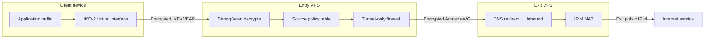
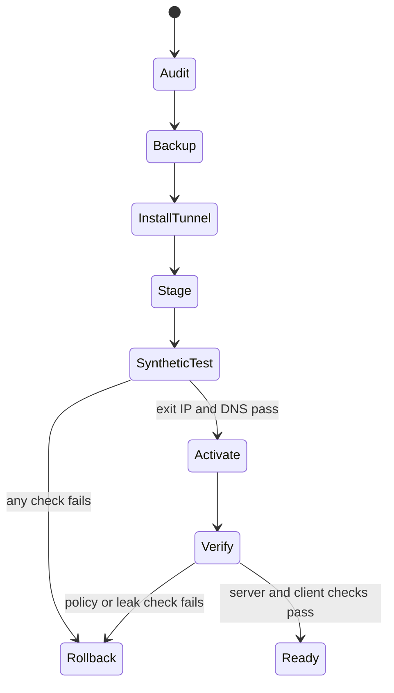

# Architecture

## Design goals

The system separates the client-facing VPN endpoint from the Internet-facing egress address while preserving familiar IKEv2/EAP enrollment. It is designed to:

- keep entry-host management traffic on the entry host's ordinary route;
- route only authenticated VPN-client IPv4 through the exit;
- fail closed instead of silently using the entry uplink;
- force conventional DNS through the exit resolver;
- survive reboots with deterministic systemd-managed state; and
- support staged verification before the live client pool changes.

## Packet path

### Outbound IPv4

1. A client authenticates to StrongSwan on the entry VPS using IKEv2/EAP.
2. StrongSwan decrypts the packet. Its source is now an address from `CLIENT_POOL`.
3. A Linux policy rule selects a dedicated routing table for that source pool.
4. The table's preferred default route points to `awg-exit`.
5. The entry firewall accepts decrypted client traffic only when it leaves through `awg-exit`.
6. The exit accepts the client pool only from `awg-exit`, applies NAT on its uplink, and sends the packet to the Internet.
7. Return traffic follows conntrack and the explicit client-pool route back through the tunnel and IKEv2 security association.

### What each observer sees

| Observer | Network information available |
|---|---|
| Client access network | An encrypted IKEv2 connection to the entry endpoint, plus any traffic the client OS excludes from the VPN |
| Entry VPS/operator | Client source address, EAP identity, connection timing/volume, and an encrypted tunnel to the exit |
| Inter-server networks | AmneziaWG transport metadata and encrypted payload |
| Exit VPS/operator | Destination addresses, ordinary DNS queries, timing/volume, and the client's shared translated egress |
| Internet service | Exit public IPv4, application data not protected end-to-end, and application/account identifiers |

## Policy routing and fail-closed behavior

The entry VPS retains its normal default route for SSH, package updates, monitoring, and local services. An `ip rule` selects a separate table only for `CLIENT_POOL`.

That table contains:

1. a low-metric default route through `awg-exit`; and
2. a persistent higher-metric blackhole default.

The `TWOHOP_ENTRY` firewall chain provides a second control: decrypted IKEv2 packets from `CLIENT_POOL` are accepted only toward `awg-exit`. If the tunnel interface or preferred route disappears, the policy table blackholes the traffic and the firewall rejects an attempted alternate forwarded path.

This controls forwarded IPv4 from the declared client pool. It intentionally does not route traffic generated by the entry VPS through the exit.

## DNS path

At the exit, TCP and UDP destination port 53 from the client pool are redirected to Unbound on the private tunnel address. This prevents a conventional DNS address supplied by a client profile from sending plaintext DNS through another egress.

DNS over HTTPS and DNS over TLS are encrypted application traffic. They are not intercepted; when the device follows the VPN route, they reach the application's chosen resolver from the exit public IPv4.

## IPv6 model

This release deliberately provides IPv4 Internet egress only.

- The clean StrongSwan installer advertises `0.0.0.0/0,::/0`.
- It assigns an IPv4 client address and a unique-local IPv6 address from `IPV6_SINK_POOL`.
- The entry rejects forwarded traffic from the IPv6 sink pool.
- Generated Android profiles set both `block-ipv4` and `block-ipv6`.
- Generated Apple profiles request `IncludeAllNetworks` and primary-route overrides.

The server can advertise and sink IPv6, but it cannot force a client operating system to route traffic that the client deliberately excludes from the VPN. Device-side verification is mandatory. A public cellular IPv6 while the VPN is connected is a leak.

## Deployment state machine

The synthetic test temporarily selects the tunnel table for `TEST_SOURCE_IP`, creates traffic with that source, and validates the observed exit IPv4 and DNS path. The complete client pool is selected only after this test succeeds.

## Persistence

Systemd starts `awg-quick@awg-exit` and the role-specific routing/firewall service after reboot. Custom iptables chains are rebuilt idempotently. The entry's dedicated table retains the blackhole fallback, and the exit restores forwarding, DNS redirection, NAT, and return routes.

## Default private networks

| Purpose | Default |
|---|---|
| IKEv2 client pool | `10.250.0.0/16` |
| IPv6 sink pool | `fd42:250::/64` |
| Staged test address | `10.249.255.254/32` |
| Exit tunnel address | `10.253.0.1/30` |
| Entry tunnel address | `10.253.0.2/30` |
| Policy table | `51831` |

Change these values when they overlap a VPS network, container network, client LAN, site-to-site range, or another policy table.

## Recommended hardening without changing the protocols

The current IKEv2 + AmneziaWG architecture is a reasonable stable baseline. Improve operations before replacing either protocol:

1. Give every person or device a separate EAP credential.
2. Use generated Android and Apple profiles so full-tunnel and IPv6 controls are not missed.
3. Replace reusable SSH passwords with dedicated deployment keys and restrict administrative ingress.
4. Keep the fail-closed blackhole and firewall checks in every verification run.
5. Test Wi-Fi, cellular, sleep/wake, and network transitions from real clients.
6. Rotate inter-server keys after a VPS replacement or suspected exposure.
7. Store encrypted recovery archives off-server and test restoration.
8. Add private uptime monitoring for service state, handshake freshness, exit IPv4, and DNS without publishing endpoints.

Standard WireGuard is simpler when inter-server traffic is not filtered. AmneziaWG is useful when obfuscation is required. Replacing a working inter-server transport does not fix client-side IPv6 routing, per-app exclusions, GPS/account location, or stale geolocation databases.

Native public IPv6 egress can be added later, but only as a complete design: routed exit prefix or NAT66 policy, exit firewall, DNS behavior, return routing, client selectors, fail-closed rules, and independent leak testing.
